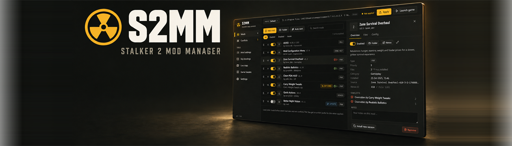
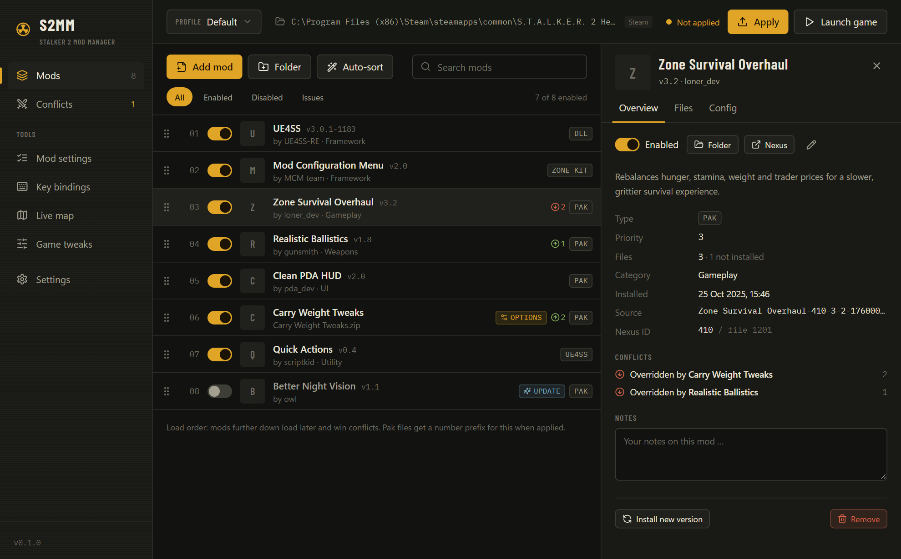
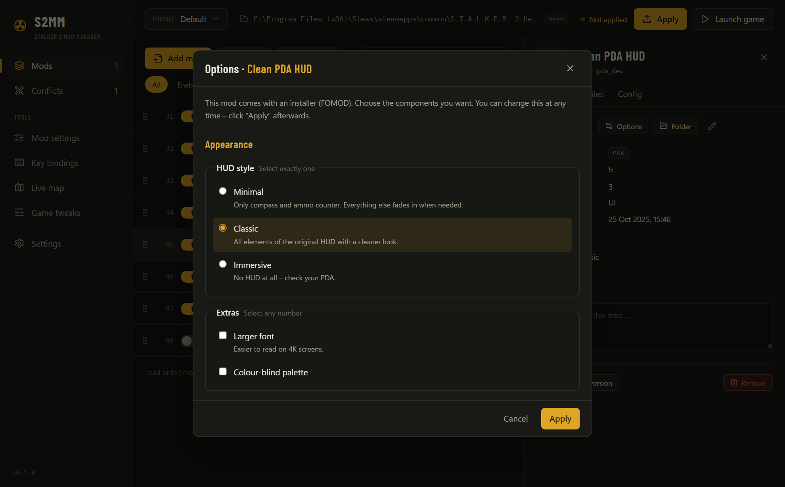
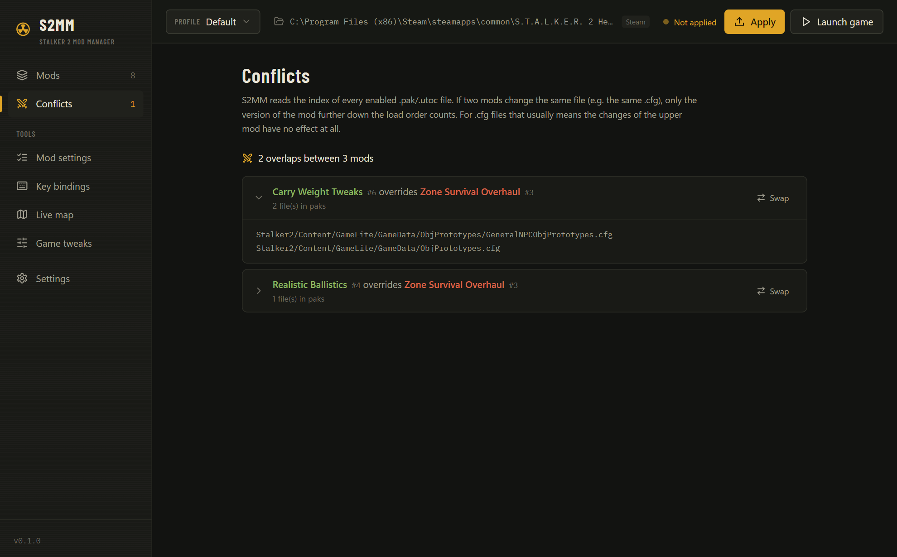
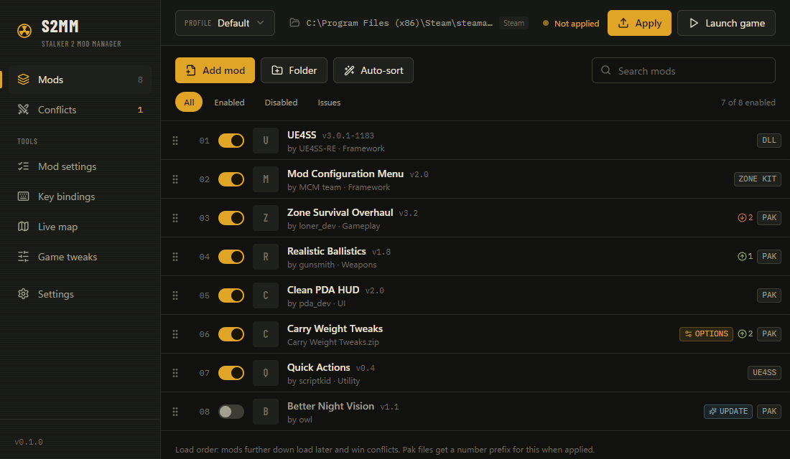
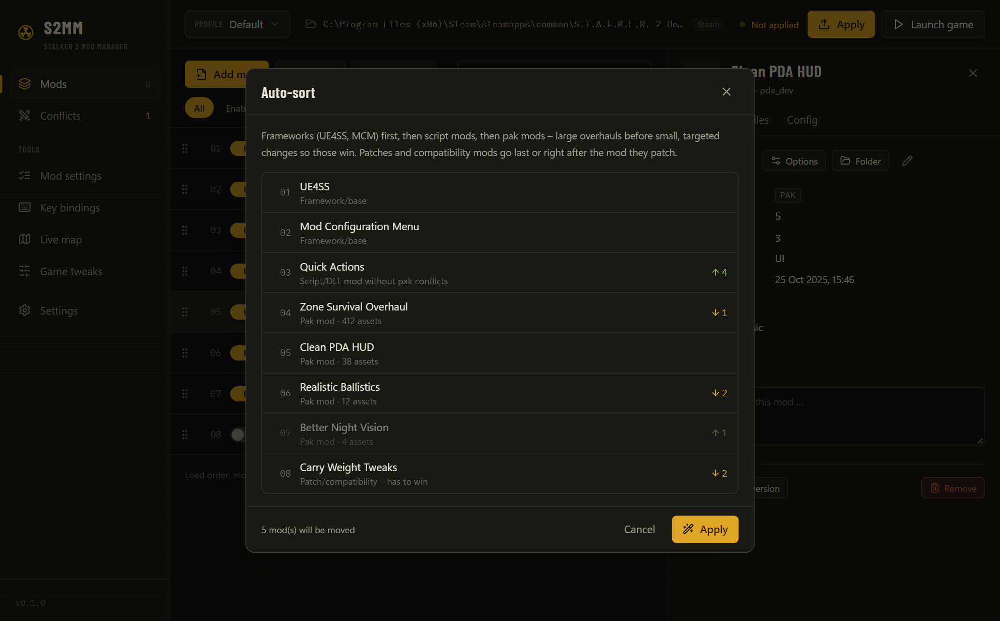
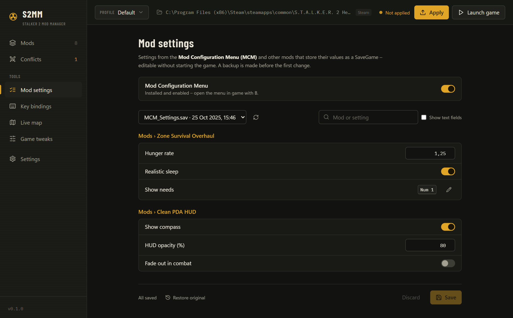
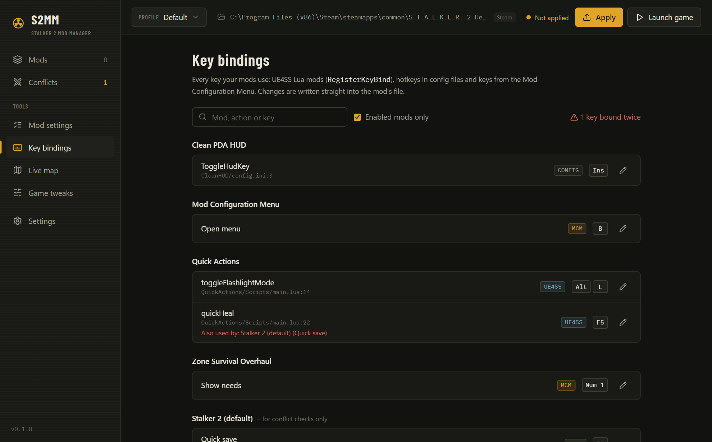
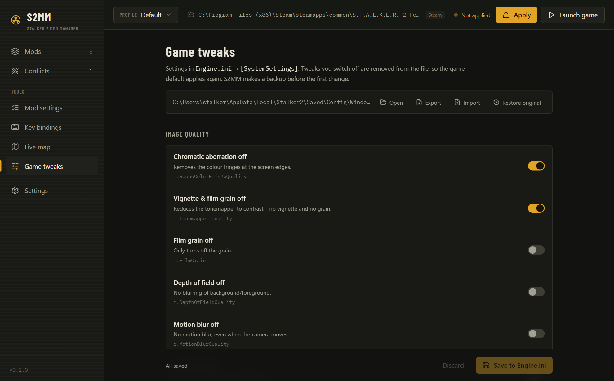
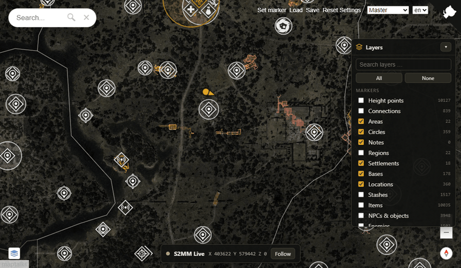

<div align="center">



# S2MM — Stalker 2 Mod Manager

Windows & Linux · English & German · Setup & Portable

[Downloads](https://github.com/LizenzFracht/Stalker2ModManager/releases) · [Report an issue](https://github.com/LizenzFracht/Stalker2ModManager/issues) · [MIT License](LICENSE)

</div>

## A personal project. Please read this first.

**This app is completely vibe-coded.** I built it with AI assistance as a hobby project for my own S.T.A.L.K.E.R. 2: Heart of Chornobyl setup. It has been working well for my purposes so far. That is my experience, not a promise that it will work just as well with every mod collection or on every system.

I do not know how regularly I will keep working on it. Updates, fixes and replies may be sporadic, and development may stop altogether. There is no support schedule or commitment to keeping up with future game patches.

The source is available under the MIT License. Use it, change it, fork it, improve it, or leave it alone.

*Take it and do whatever you want with it. Or don't.*

## What it does

### Mod installation

Drop ZIP, 7z or RAR archives, loose `.pak` / `.utoc` / `.ucas` files, DLL/ASI plugins or folders into the app. S2MM recognises classic pak mods, Zone Kit mods, UE4SS Lua mods and binary plugins, and places them in the appropriate locations.

Mods with FOMOD installers or multiple variants get an options dialog. You can revisit those choices later without downloading the archive again.



<details>
<summary>Installation formats and destinations</summary>

| Mod type | Destination inside the game folder |
| --- | --- |
| Classic pak mods | `Stalker2/Content/Paks/~mods` with a load-order prefix and `_P` suffix |
| Zone Kit mods | `Stalker2/Mods/<Name>/Content/Paks/Windows` |
| UE4SS Lua mods | The installation's UE4SS `Mods` directory |
| DLL / ASI plugins and UE4SS | The installation's binaries directory |
| Loose game files | Their matching path inside `Stalker2/` |



</details>

### Load order and conflicts

Reorder mods by drag and drop. Mods further down the list take priority. Inspect overlapping files to see which mod overrides another, or preview an auto-sort suggestion before applying it.

Conflict detection reads pak and IoStore indexes. It helps identify overlapping content; it does not establish whether an entire mod collection is compatible.



<details>
<summary>Reordering and auto-sort preview</summary>





</details>

### Profiles and deployment

Keep separate mod profiles, including a built-in Vanilla profile. Mods live in a separate library and are hard-linked or copied into the game. Original files replaced during managed deployment are backed up.

Restore Vanilla can also move manually installed mods into a dated backup folder. Review its options before applying it.

S2MM keeps a recovery copy of its state and metadata alongside staged mods. If library entries need to be recovered, they are added disabled so you can review them before applying anything.

### Mod settings and key bindings

**Mod Configuration Menu support is optional.** S2MM can edit settings stored in an existing MCM settings file without launching the game. MCM must be installed separately and is not included with S2MM. Available settings depend on your installed mods and their MCM support.

Independently of MCM, you can inspect key bindings found in mod scripts and configuration files, spot duplicate bindings, and edit supported bindings or `.ini`, `.lua` and `.json` config files from the app.



<details>
<summary>Key bindings overview</summary>



</details>

### Engine.ini tweaks

Change selected graphics and engine settings, add your own CVars, and import or export `Engine.ini` files. S2MM backs up the file before its first modification. Optional read-only protection prevents the game from overwriting the file when it exits; S2MM can still edit it.



### Live map

Open [joric's interactive map](https://github.com/joric/stalker) in your browser and display your in-game position and viewing direction, with follow mode and layer filters.

**Position tracking requires working UE4SS and the included S2MM Live-Map mod.** UE4SS is a separate project that S2MM can download and install on request. Game updates can break it; when UE4SS cannot start, Lua mods and live position tracking cannot work.

The map server runs on your own PC. The Lua mod writes position data to `%LOCALAPPDATA%\S2MM-Live\live.json` on Windows, or the corresponding location inside the game's Proton prefix on Linux.



*Interface screenshots use example mod data.*

## Download and get started

Get the available packages from [GitHub Releases](https://github.com/LizenzFracht/Stalker2ModManager/releases).

| Platform | Setup | Portable |
| --- | --- | --- |
| Windows 10/11, x64 | `S2MM_<version>_windows_x64_setup.exe` | `S2MM_<version>_windows_x64_portable.zip` |
| Linux, x86-64 — experimental | `S2MM_<version>_linux_amd64_setup.deb` | `S2MM_<version>_linux_x86_64_portable.AppImage` |

**Windows is the locally tested platform. Linux/Proton support has not been personally tested on a Linux system.** The release workflow builds Linux packages on GitHub Actions; availability depends on the release.

1. Back up your saves and any existing manual mod setup.
2. Start S2MM and check the detected game folder.
3. Drop your downloaded mod archives into the app.
4. Choose installation options, arrange the load order and review conflicts.
5. Close the game, click **Apply**, then launch the game.

For Windows portable mode, extract the archive into a writable folder and run `S2MM.exe`. Its data stays beside it. You can also enable portable mode with an empty `portable.txt` beside the program; the data folder is `S2MM-Data` (older installations may use `S2MM-Daten`).

The Windows build is not code-signed, so Windows may show a SmartScreen warning. You can build from source if you prefer.

### Nexus Mods downloads

The built-in Nexus API integration is **disabled in public builds pending application registration**. Download mods in your browser and drop the archives into S2MM. MCM and other third-party mods are not bundled with the app.

### Linux / Proton

Linux support targets a Steam/Proton installation of Stalker 2. To use UE4SS under Proton, add the following to the game's Steam launch options:

```text
WINEDLLOVERRIDES="dwmapi=n,b" %command%
```

On Linux, make a downloaded AppImage executable before running it. This platform still needs testing and feedback.

## Source, feedback and contributions

Bug reports and contributions are welcome. If you [report an issue](https://github.com/LizenzFracht/Stalker2ModManager/issues), include your app version, game version, platform and steps to reproduce it. Please do not include API keys or other private information.

I may not be able to investigate or reply. If you want to take the project in your own direction, you are welcome to fork it under the MIT License.

### Building from source

You need Rust, Node.js 20.11 or newer, and the [Tauri prerequisites](https://tauri.app/start/prerequisites/) for your platform.

```sh
npm ci
npm run tauri dev          # desktop app
npm run dev                # browser preview with example data
npm run build              # TypeScript check and frontend build
cd src-tauri
cargo test --locked
```

From the repository root, `npm run release` builds the local platform's setup and portable packages into `release/`. The build script remaps personal source paths out of the Rust binary. The release workflow creates a draft release when a `v*` tag is pushed.

`node scripts/ui-regression.mjs` exercises the browser preview's protection toggle, draft preservation and diagnostics using Chrome or Chromium. Set `CHROME_PATH` if it is not found automatically. These tests use example data and do not touch your installed game.

`cargo build --features nexus` enables the Nexus integration for development. Public distribution with that feature requires application registration under the [Nexus API policy](https://help.nexusmods.com/article/114-api-acceptable-use-policy).

## Credits

- [joric](https://github.com/joric/stalker) — interactive S.T.A.L.K.E.R. 2 map (Unlicense)
- [UE4SS / RE-UE4SS](https://github.com/UE4SS-RE/RE-UE4SS) — Lua scripting framework and game configuration (MIT)
- **Mod Configuration Menu authors** — MCM support; S2MM edits the settings files created by their mod
- [uesave](https://github.com/trumank/uesave-rs) — Unreal SaveGame handling (MIT)
- **UnRAR**, by Alexander Roshal / RARLAB — RAR extraction, under its own license
- **Tauri, React, Tailwind CSS, dnd-kit, Lucide, Barlow Condensed, IBM Plex Mono**, and the other projects listed in [THIRD_PARTY_NOTICES.md](THIRD_PARTY_NOTICES.md) and the app's About screen
- Inspired by **Definitive Mod Manager** and [CDUMM](https://github.com/faisalkindi/CrimsonDesert-UltimateModsManager) for Crimson Desert

Created with AI assistance using **Claude by Anthropic** and **Codex by OpenAI**. The app is completely vibe-coded.

*If you have any concerns about how your work is used or credited in this project, please reach out.*

## License

S2MM is released under the [MIT License](LICENSE). Third-party components retain their respective licenses.

This is an unofficial fan project. It is not affiliated with or endorsed by GSC Game World, Nexus Mods, Valve or Microsoft. S.T.A.L.K.E.R. and S.T.A.L.K.E.R. 2: Heart of Chornobyl are trademarks of GSC Game World.
