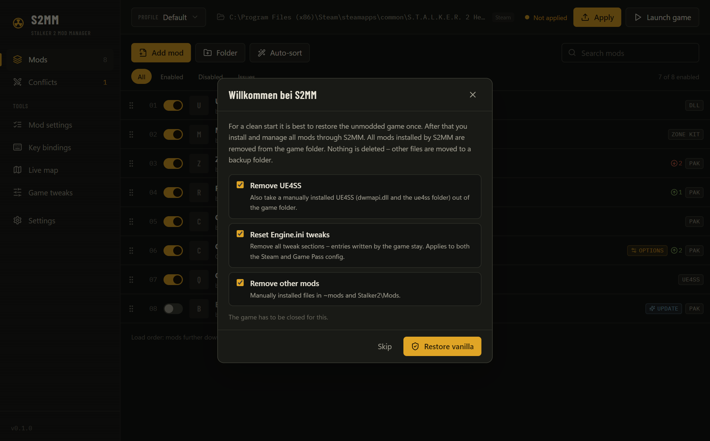

<div align="center">


# S2MM – Stalker 2 Mod Manager

**Install, sort and conflict-check mods for S.T.A.L.K.E.R. 2: Heart of Chornobyl – and follow yourself on a live map.**

[](https://github.com/LizenzFracht/Stalker2ModManager/actions/workflows/ci.yml)
[](https://github.com/LizenzFracht/Stalker2ModManager/releases/latest)
[](LICENSE)


</div>

## Download

| | Setup | Portable |
| --- | --- | --- |
| **Windows 10/11** (x64) | `S2MM_x.y.z_windows_x64_setup.exe` | `S2MM_x.y.z_windows_x64_portable.zip` – unzip and run, data stays in the folder |
| **Linux** (x86_64) | `S2MM_x.y.z_linux_amd64_setup.deb` | `S2MM_x.y.z_linux_x86_64_portable.AppImage` – `chmod +x` and run |

➜ **[Latest release](https://github.com/LizenzFracht/Stalker2ModManager/releases/latest)** · every release also lists SHA-256 checksums.

> Windows may show a SmartScreen warning because the app is not code-signed. Choose *More info → Run anyway*,
> or build it yourself from source (see below).

## Features

### Mods in every format
Drop archives (**ZIP, 7z, RAR**), loose **.pak / .utoc / .ucas**, **DLL/ASI** plugins or whole folders into the window.
S2MM recognises how the mod is packed and where it belongs:

| Mod type | Goes to |
| --- | --- |
| Pak mods (classic) | `Stalker2/Content/Paks/~mods` – renamed with a load-order prefix and `_P` |
| Zone Kit mods (official format) | `Stalker2/Mods/<Name>/Content/Paks/Windows` |
| UE4SS Lua mods | `Stalker2/Binaries/Win64/ue4ss/Mods/<Name>` |
| DLL / ASI plugins, UE4SS itself | `Stalker2/Binaries/Win64` |
| Loose game files | the matching path inside `Stalker2/` |

Mods with a **FOMOD installer** or several **variant folders** (`x2/`, `x5/` …) get an options dialog – and you can
change your choice later without reinstalling.


### Load order, conflicts and auto-sort
Reorder mods by drag & drop – mods further down win. S2MM reads the index of **every pak and IoStore container** and shows
exactly which `.cfg` or asset one mod overrides in another. One click on *Swap* fixes the order;
**Auto-sort** proposes a sensible order with a reason for every move.

<p>


</p>


### Safe by design
* Mods live in their own library and are **hard-linked** (or copied) into the game – nothing is extracted into the game folder by hand.
* Only files S2MM placed are ever removed. Game files a mod replaces are **backed up and restored**.
* **Restore vanilla** (offered on first start) removes all mods and – if you want – a manually installed UE4SS, other mods and
  all Engine.ini tweaks. Nothing is deleted: everything goes into a dated backup folder.
* The built-in, read-only **Vanilla** profile plus as many own profiles as you like.



### Mod settings (MCM) and key bindings
* Edit the settings of the **Mod Configuration Menu** (`MCM_Settings.sav`) without starting the game – switches, numbers, keys.
* See **every key your mods bind** (UE4SS `RegisterKeyBind`, config files, MCM), spot **double bindings** – also against the
  game's default keys – and rebind with a key press.
* Edit a mod's `.ini`, `.lua` or `.json` config right inside S2MM.

<p>


</p>

### Live map
S2MM starts a small local web server (only reachable from your PC) that opens
[joric's interactive Stalker 2 map](https://github.com/joric/stalker) in your browser and shows **your in-game position and
viewing direction live**, with a *Follow* mode and a layer filter. A tiny bundled UE4SS mod reports the position once per second.


### Game tweaks
Curated Engine.ini switches (chromatic aberration, vignette, film grain, depth of field, motion blur, sharpening, texture pool,
shader cache, view distance …), your own CVars, **import/export** of whole `Engine.ini` files and a one-click restore.


### More
* **UE4SS on demand** – downloads the current release from GitHub including the Stalker 2 config (Steam or Game Pass) and
  installs it as a mod you can toggle.
* Detects **Steam, Game Pass/Xbox, GOG and Epic** installs; warns after a game update.
* **English and German** UI, following your system language (switchable in the settings).
* **Portable mode**: put an empty `portable.txt` next to the program and all data stays in `S2MM-Data/`.

## Linux

S2MM runs natively on Linux and manages a Steam/Proton install of Stalker 2. The game's config, MCM settings and the live
map data are found inside the Proton prefix
(`steamapps/compatdata/1643320/pfx/drive_c/users/steamuser/AppData/Local`). UE4SS works under Proton when you add
`WINEDLLOVERRIDES="dwmapi=n,b" %command%` to the game's launch options in Steam.

## Nexus Mods integration

S2MM contains a full Nexus Mods integration (“Mod Manager Download” links, update checks, direct downloads for Premium
users). Public builds ship with it **switched off** until S2MM is registered as an application with Nexus Mods, as their
[API policy](https://help.nexusmods.com/article/114-api-acceptable-use-policy) requires. Until then: download mods in your
browser and drop the archive into S2MM – the Nexus mod ID and version are read from the file name.

## Building from source

Requirements: [Rust](https://rustup.rs/) (stable), Node.js 20+, and on Linux the
[Tauri prerequisites](https://tauri.app/start/prerequisites/) (`libwebkit2gtk-4.1-dev` etc.).

```bash
npm install
npm run tauri dev          # run the app
npm run dev                # UI only, in the browser with sample data
npm run release            # setup + portable packages into ./release
cd src-tauri && cargo test # tests, incl. an end-to-end run against a fake game folder
```

`cargo build --features nexus` enables the Nexus Mods integration. `node scripts/screenshots.mjs` renders the images in
`docs/media`, `node scripts/third-party-notices.mjs` updates `THIRD_PARTY_NOTICES.md`.

Releases are built by GitHub Actions when a tag `v*` is pushed (see `.github/workflows/release.yml`).

### Adding a language
Copy `src/locales/en.ts` to e.g. `src/locales/uk.ts`, translate the values (the keys are the German source texts) and
register it in `src/i18n.ts`. Backend messages use the `tr!` macro in `src-tauri/src/i18n.rs`.

## Credits

S2MM stands on the shoulders of others – thank you!

* **[joric](https://github.com/joric/stalker)** – the interactive Stalker 2 map used by the live map (Unlicense)
* **[UE4SS (RE-UE4SS)](https://github.com/UE4SS-RE/RE-UE4SS)** – Lua scripting for Unreal Engine and the Stalker 2 game config (MIT)
* **Mod Configuration Menu (MCM)** for Stalker 2 and its authors – S2MM edits the settings file MCM creates
* **[uesave](https://github.com/trumank/uesave-rs)** by trumank – Unreal SaveGame reading/writing (MIT)
* **UnRAR** by Alexander Roshal / [RARLAB](https://www.rarlab.com/) – RAR extraction (UnRAR license)
* **[Tauri](https://tauri.app/)**, React, Tailwind CSS, dnd-kit, Lucide icons, the fonts **Barlow Condensed** and
  **IBM Plex Mono** (SIL Open Font License) and many Rust crates – see [THIRD_PARTY_NOTICES.md](THIRD_PARTY_NOTICES.md)
* Inspired by the Crimson Desert mod managers **Definitive Mod Manager** and
  **[CDUMM](https://github.com/faisalkindi/CrimsonDesert-UltimateModsManager)**

S2MM was built with the help of AI (Claude by Anthropic).

## License and disclaimer

S2MM is released under the [MIT License](LICENSE). Third-party components keep their own licenses, listed in
[THIRD_PARTY_NOTICES.md](THIRD_PARTY_NOTICES.md) and in the app under *Settings → About S2MM*.

This is an unofficial fan project. It is not affiliated with or endorsed by GSC Game World, Nexus Mods, Valve or Microsoft.
S.T.A.L.K.E.R. and S.T.A.L.K.E.R. 2: Heart of Chornobyl are trademarks of GSC Game World. Use mods at your own risk and keep
backups of your saves.
